# iPhone Manager

**A free, open-source iPhone manager for Windows, macOS and Linux.** Browse and export your photos (including what's only in
iCloud), manage apps and files, see and control the iPhone's screen from the PC, and update iOS without
erasing anything, all from a local app in your browser.

English · [Português (Brasil)](README.pt-BR.md)

<a href="https://alternativeto.net/software/iphone-manager/about/?utm_source=badge&utm_medium=referral"></a>

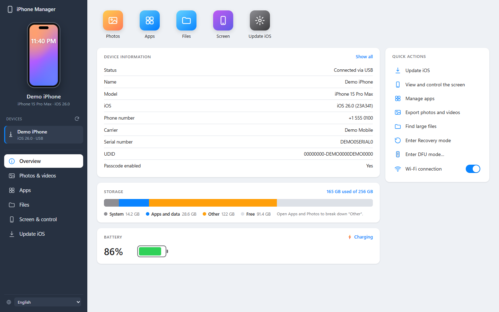

> Screenshots come from the built-in [demo mode](#demo-mode), which uses made-up data and free stock photos
> from [Lorem Picsum](https://picsum.photos) / [Unsplash](https://unsplash.com/license).

## Features

| | |
|---|---|
| **Overview** | Model, iOS version, battery, storage breakdown, serial/IMEI/MAC details, Wi-Fi connection switch, Recovery and DFU mode. |
| **Photos & videos** | The whole library from the Photos database: albums and folders, favorites, hidden, recently deleted, media types (Live Photos, portraits, selfies, screenshots…). Sort by date or size, group by day/month/year. |
| **iCloud Photos** | Sign in with your Apple ID to view, play, download and delete items that are only in iCloud ("Optimize iPhone Storage"). |
| **Export** | Download a selection or everything, organized by month, with optional HEIC→JPG conversion and Live Photo videos. Files already downloaded are skipped. |
| **Video preview** | Plays iPhone HEVC videos (which Windows browsers can't decode) by converting them on the fly with ffmpeg, with seeking. |
| **Delete photos** | Deletes from the iPhone the same way the Windows Photos app does: the iPhone itself removes them, so the library stays consistent (Windows only for now). |
| **Apps** | Every installed app with icon, version, app and data size. Uninstall apps; browse, upload and download the Documents of apps that share files. |
| **Files** | Browse the iPhone's media partition and app Documents. "All files" mode flattens a folder tree to find the largest files. Upload, download, new folder, delete. |
| **Backups** | Full iPhone backups in the iTunes/Finder format (incremental, optionally encrypted) that you can restore after a recovery or a failed update. Back up and restore **one app's data**, **Messages**, **Contacts**, call history, Notes, Calendar or Safari bookmarks on their own, without touching anything else. |
| **Screen & control** | Live mirror of the iPhone's screen. Click to tap, drag to swipe, type with the PC keyboard, hardware buttons (Home, Lock, Volume, Siri). |
| **Update iOS** | Lists versions Apple still signs, downloads the IPSW (SHA1-checked) and **updates without erasing**, after 11 safety checks. |
| **Languages** | English and Português (Brasil), switchable at the bottom of the sidebar. [Add yours](#translations). |

<table>
<tr><td></td><td>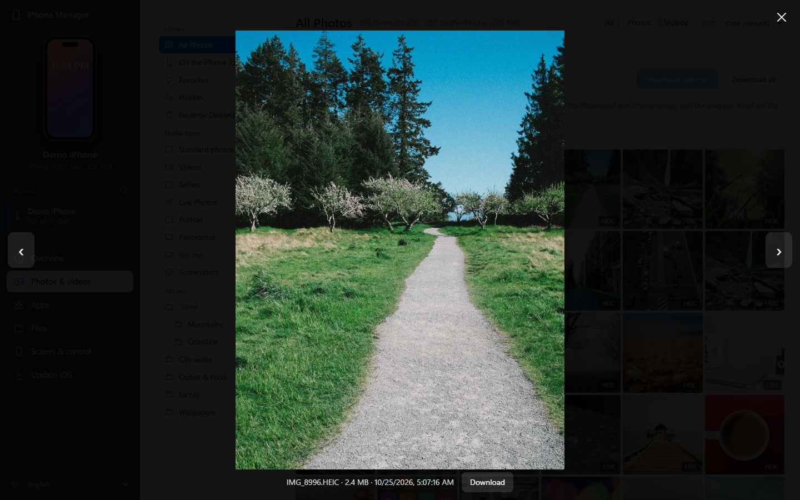</td></tr>
<tr><td align="center">Photo library with albums and media types</td><td align="center">Preview</td></tr>
<tr><td>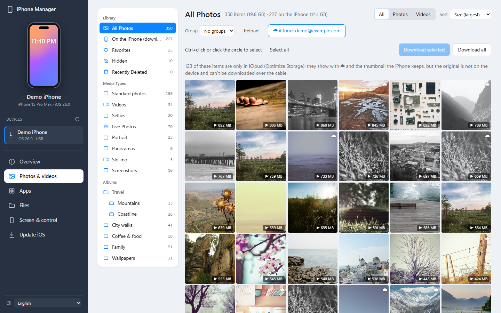</td><td>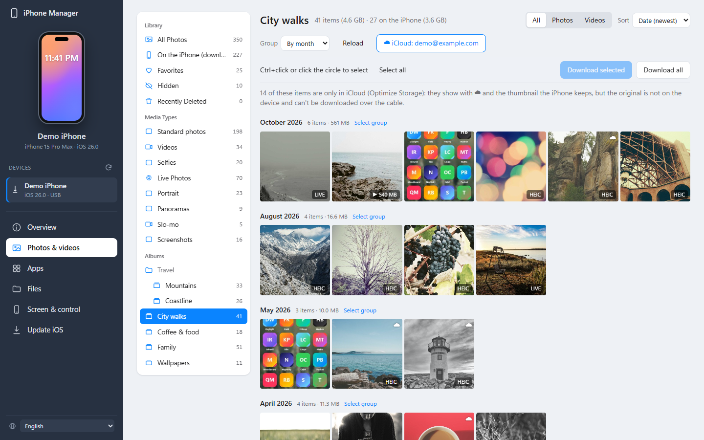</td></tr>
<tr><td align="center">Sorted by size, to find what takes the most space</td><td align="center">Albums and folders</td></tr>
<tr><td>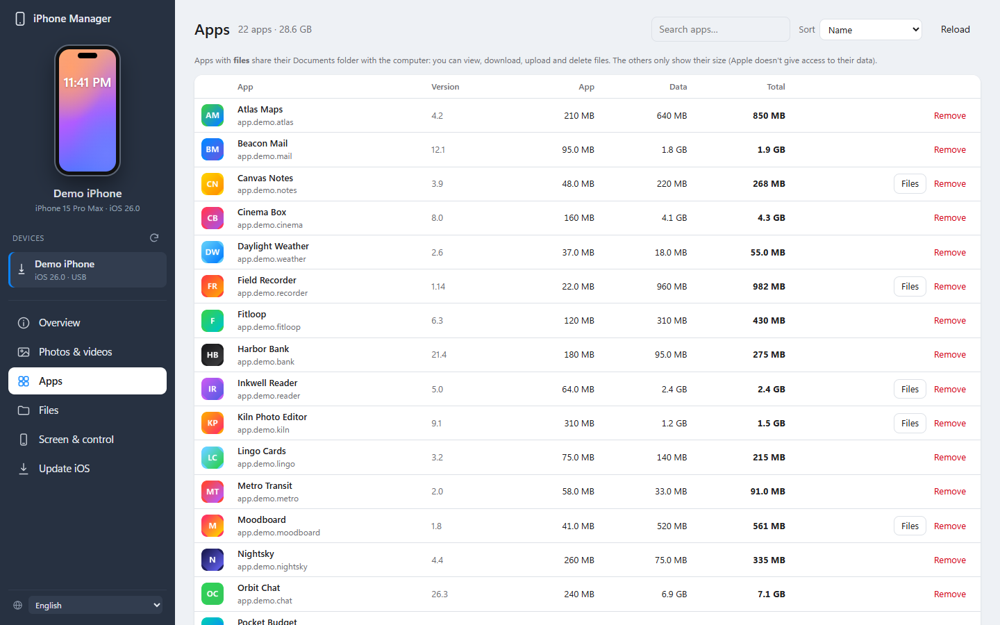</td><td>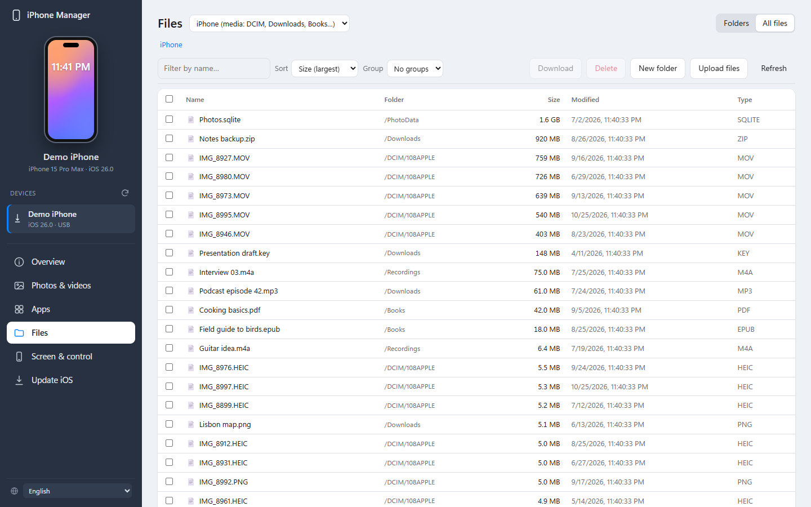</td></tr>
<tr><td align="center">Apps with sizes</td><td align="center">Largest files anywhere on the device</td></tr>
<tr><td>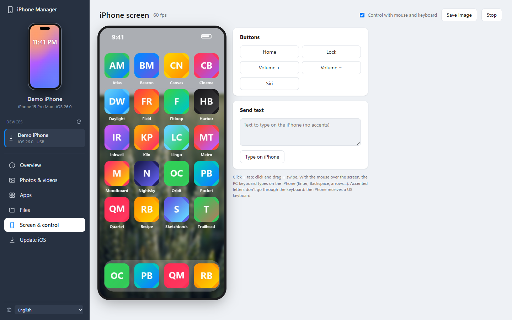</td><td>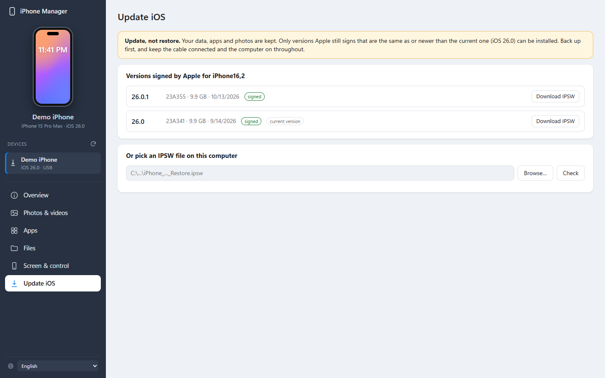</td></tr>
<tr><td align="center">Screen mirroring and remote control</td><td align="center">iOS update (keeps your data)</td></tr>
<tr><td>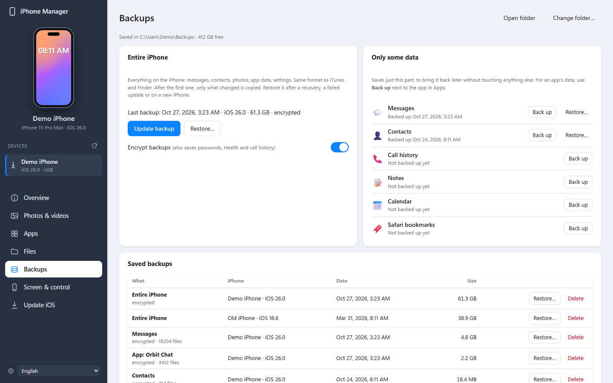</td><td>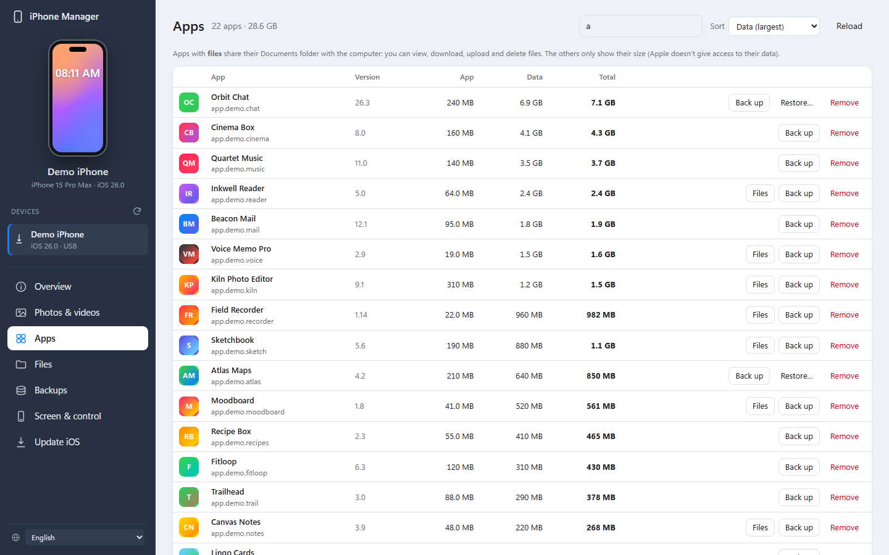</td></tr>
<tr><td align="center">Full and partial backups</td><td align="center">Back up and restore a single app</td></tr>
<tr><td>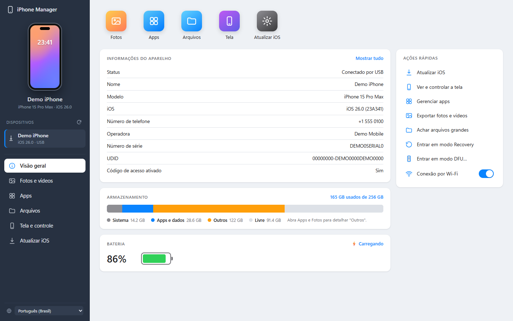</td><td>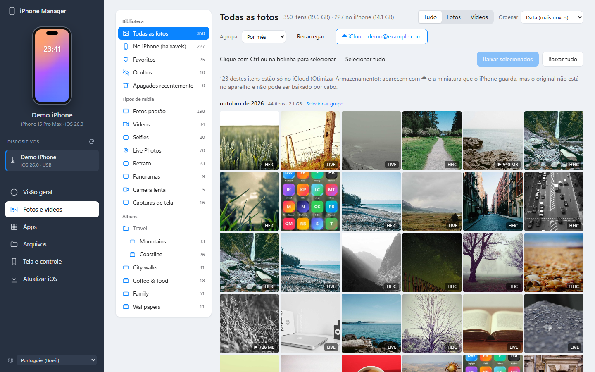</td></tr>
<tr><td align="center" colspan="2">Em português</td></tr>
</table>

## Install

### Windows

1. Download **`iPhoneManager-Setup-<version>.exe`** from the
   [Releases](https://github.com/tmkaio/iphone-manager/releases) page and run it. It installs for your user only
   (no administrator rights) and adds a Start menu shortcut.
2. On the **Select Components** page everything is selected by default. Untick what you don't want:
   - **ffmpeg**: plays iPhone videos inside the app. Setup downloads an official Windows build
     ([gyan.dev](https://www.gyan.dev/ffmpeg/builds/), about 115 MB) and checks its SHA-256.
   - **Apple Devices** (Microsoft Store): Apple's driver and service for talking to the iPhone. Setup installs
     it with `winget`, and Windows may ask for permission. This item only shows up when the driver is missing.
     iTunes and [iMazing](https://imazing.com) also bring it.

   iPhone Manager doesn't ship Apple's software or ffmpeg inside the installer. Setup fetches them from their
   official sources (see [How it works](#how-it-works)).
3. Connect the iPhone with a USB cable, unlock it and tap **Trust**.

The app opens in its own window (Microsoft Edge in app mode) at `http://127.0.0.1:8765`. It only listens on
your own computer.

> The installer isn't code-signed yet, so Windows SmartScreen may warn about it: choose **More info › Run anyway**.

### macOS (new, beta)

1. Download **`iPhoneManager-<version>-macOS-arm64.dmg`** from
   [Releases](https://github.com/tmkaio/iphone-manager/releases). It runs on Macs with Apple silicon (M1 and
   later); Intel Macs aren't supported.
2. Open it and drag **iPhone Manager** to **Applications**.
3. Open it from Applications, connect the iPhone with a USB cable, unlock it and tap **Trust**.

macOS has Apple's iPhone service built in, so there is nothing else to install. The app has no Dock icon:
it opens its window in Google Chrome, Microsoft Edge, Brave or Chromium (app mode) if one is installed,
otherwise in your default browser. Opening the app again shows the window again. For video previews,
install ffmpeg with [Homebrew](https://brew.sh): `brew install ffmpeg`.

### Linux (new, beta)

1. Install usbmuxd (Apple's iPhone service) from your distribution, e.g. `sudo apt install usbmuxd`.
2. Download **`iPhoneManager-<version>-x86_64.AppImage`** (or `aarch64`) from
   [Releases](https://github.com/tmkaio/iphone-manager/releases), make it executable and run it:
   `chmod +x iPhoneManager-*.AppImage && ./iPhoneManager-*.AppImage`
3. Connect the iPhone with a USB cable, unlock it and tap **Trust**.

For video previews install ffmpeg (`sudo apt install ffmpeg`). Recovery mode and iOS updates talk to the
iPhone over USB directly; if your user can't open it, add a udev rule such as
`SUBSYSTEM=="usb", ATTR{idVendor}=="05ac", MODE="0666"` in `/etc/udev/rules.d/39-iphone.rules`.

## Requirements

- Windows 10 or 11 (64-bit), macOS 11 or later on Apple silicon, or a Linux with glibc 2.35+ (Ubuntu 22.04, Debian 12, Fedora 36…).
- Apple's iPhone service: on Windows Apple Devices, iTunes or iMazing (Setup installs Apple Devices if
  needed); built into macOS; the `usbmuxd` package on Linux.
- An iPhone or iPad. Most features work on any recent iOS. Screen mirroring needs iOS 17 or later with
  **Developer Mode** turned on (Settings › Privacy & Security › Developer Mode).
- Optional: ffmpeg for video previews. Setup installs it; from source, put it on `PATH`.

## Using it

### Photos and iCloud
The sidebar mirrors the Photos app: library, favorites, hidden, recently deleted, media types and your albums
and folders. Items marked ☁ are only in iCloud: the iPhone keeps a thumbnail but not the original.

Click **☁ Connect iCloud** and sign in with your Apple ID to open, download or delete those items. Your password
goes straight to Apple and isn't stored. After the two-factor code, the computer is trusted and the app
reconnects on its own. This uses iCloud's web service, so it doesn't work with
[Advanced Data Protection](https://support.apple.com/en-us/102651) turned on.

**Deleting:**
- *On the iPhone:* the iPhone deletes the items itself, like the Windows Photos app does. With iCloud Photos on,
  they're also removed from iCloud. In our tests this skipped *Recently Deleted*, so download first what you
  want to keep.
- *Only in iCloud:* the items go to *Recently Deleted* on all your devices, where you can recover them for 30 days.

### Screen and control
The first time, the app downloads Apple's Developer Disk Image for your device (about 17 MB) and mounts it.
It changes nothing on the iPhone and disappears when the iPhone restarts. Then: click = tap, drag = swipe,
the PC keyboard types on the iPhone. Mirroring stops by itself 90 seconds after nobody is watching.

### Backups
**Entire iPhone** makes a full backup, the same as iTunes or Finder: the first one copies everything (it can
take a while), the next ones only what changed. Restore it after a recovery, an update that went wrong, or on a
new iPhone. Turn on **Encrypt backups** to also keep saved passwords, Health, call history and Wi-Fi networks;
without that password an encrypted backup can't be restored, so keep it safe.

**Only some data** and the **Back up** button next to each app save just that part: Messages (with
attachments), Contacts, call history, Notes, Calendar, Safari bookmarks, or one app's data (documents,
settings, chats, including the app's shared containers). iOS can only restore whole backups, so
**Restore…** does what iMazing does: it backs up the iPhone as it is now, puts the saved part in place of the
current one, and restores that merged backup. Everything else comes back exactly as it was a minute earlier.

Before restoring, turn off **Find My** on the iPhone and keep the cable connected; the iPhone restarts at the
end. If Messages, Contacts or Notes sync with iCloud, iCloud brings its own copy back afterwards. Backups are
saved in `%LOCALAPPDATA%\iPhoneManager\Backups` (change it with **Change folder…**).

### Updating iOS
Only versions Apple still signs and that are the same as or newer than the installed one are offered: it is an
**update, not a restore**, so data, apps and photos are kept. Before starting, the app checks the USB
connection, that the IPSW matches the model and board, that it has the update (no-erase) mode, the version,
Apple's signature, file size and integrity, that it's the same iPhone (ECID), battery level, and free space
on the iPhone and the PC. Any failed or unverifiable check blocks the update. Keep the cable connected until
it's done. A log of each update is saved under `%LOCALAPPDATA%\iPhoneManager\logs\`.

### Wi-Fi
With the cable connected, turn on **Wi-Fi connection** in the Overview. Afterwards the iPhone also shows up
without a cable on the same network (the refresh button next to *Devices* looks for it). Updates and screen
mirroring need the cable.

## How it works

iPhone Manager is a small [FastAPI](https://fastapi.tiangolo.com) server on `127.0.0.1` plus a plain HTML/JS
interface (`app/static`). It talks to the device with
[pymobiledevice3](https://github.com/doronz88/pymobiledevice3) through Apple's usbmuxd service
(`AppleMobileDeviceProcess.exe`, port 27015, on Windows; `/var/run/usbmuxd` on macOS and Linux).
`app/system.py` holds what differs between the three systems; Recovery and DFU go through Apple's
`MobileDevice.dll` on Windows (`app/modes.py`) and libusb elsewhere (`app/modes_usb.py`).

| Module | What it does |
|---|---|
| `app/device.py` | Device discovery (USB and Wi-Fi), lockdown sessions, device info. |
| `app/albums.py`, `app/sqlite_remote.py` | Reads the Photos database (`/PhotoData/Photos.sqlite`, often over 1 GB) **in place**: only the B-tree pages it needs, in batched parallel reads (~60 MB, a few seconds), with the WAL applied. |
| `app/photos.py` | Camera roll over AFC, thumbnails, previews (HEIC → JPEG), exports. |
| `app/ptp.py` | Photo deletion over PTP through the Windows Shell, so the iPhone updates its own library. Deleting files from `DCIM` directly would corrupt it. |
| `app/icloud.py` | iCloud Photos via [pyicloud](https://github.com/timlaing/pyicloud): sign-in with 2FA, CloudKit lookups by the asset id stored in the iPhone's database, downloads and deletion. |
| `app/video.py` | ffmpeg live conversion of HEVC to H.264 fragmented MP4, with seeking. |
| `app/backups.py` | mobilebackup2 (iTunes/Finder backup protocol): incremental full backups, restore, encryption. Partial backups are pruned copies of the full backup's `Manifest.db`; restoring one merges it into a fresh backup (hard links, per-file keys rewrapped for encrypted backups) and restores the result. |
| `app/files.py` | AFC and house_arrest (app Documents), recursive scans, app list and sizes, uninstall. |
| `app/screen.py`, `app/mirror.py`, `app/mount_ddi.py` | Developer Disk Image mounting and CoreDevice screen streaming + HID input over a userspace RSD tunnel (no admin rights). The HEVC stream is decoded with PyAV and served as MJPEG. |
| `app/modes.py`, `app/mobiledevice.py` | Apple's `MobileDevice.dll` through ctypes: Recovery/DFU detection, entering and leaving Recovery, starting the device service. |
| `app/firmware.py`, `app/preflight.py`, `app/irecv_md.py`, `app/restore_runner.py` | Signed firmware list (ipsw.me), IPSW download, safety checks and the no-erase update. libusb can't open a device in Recovery with Apple's driver, so the restore's Recovery-mode transport is rebuilt on `MobileDevice.dll` (no Zadig/WinUSB driver swap needed). |
| `app/i18n.py`, `app/static/i18n.js` | Translations. |

### Privacy
Everything runs on your computer. The app connects only to your iPhone; to Apple (IPSW downloads, signing
status via [ipsw.me](https://ipsw.me), the Developer Disk Image, and iCloud when you sign in); and to
ipsw.me for model names. iCloud session cookies are stored in `%LOCALAPPDATA%\iPhoneManager\icloud\` (sign out
removes them); your password is never stored.

## Development

Requires Python 3.13 and Git.

```bash
git clone https://github.com/tmkaio/iphone-manager.git
cd iphone-manager
python -m venv .venv
.venv/Scripts/python -m pip install -r requirements.txt
.venv/Scripts/python run.py
```

`run.py --no-window` starts only the server. `Iniciar.bat` does the same as `run.py` from Explorer.

### Demo mode
Run the real interface on made-up data, with no iPhone connected:

```bash
.venv/Scripts/python -m app.demo --fetch
.venv/Scripts/python -m app.demo
```

The first command downloads free stock photos into `build/demo-assets`. The second serves the demo at
http://127.0.0.1:8790. Every action pretends to succeed and nothing touches a device.
`scripts/screenshots.py` regenerates the screenshots in `docs/screenshots` from it with headless Edge.

### Building the installers
See [`installer/`](installer/). `installer/build.ps1` builds the self-contained app folder and, with
[Inno Setup 6.5 or newer](https://jrsoftware.org/isinfo.php), the setup `.exe`. `installer/build-unix.sh` builds
the macOS `.dmg` or the Linux AppImage on that system (it needs [uv](https://docs.astral.sh/uv/)). Pushing a tag
such as `v1.0.0` runs [the release workflow](.github/workflows/release.yml), which builds all of them on GitHub
Actions and attaches them to a GitHub Release.

The macOS app is signed with a Developer ID and notarized when the repository has these secrets:
`MACOS_CERT_P12` (the *Developer ID Application* certificate as a base64 `.p12`), `MACOS_CERT_PASSWORD`,
`APPLE_API_KEY_P8` (an App Store Connect API key), `APPLE_API_KEY_ID` and `APPLE_API_ISSUER_ID`. Without
them it is signed ad hoc, and macOS asks to allow it in **System Settings › Privacy & Security**.

### Translations
Strings are written in English in the code (`t("…")` in JavaScript, `_("…")` in Python). Each language is a
dictionary from the English text to the translation:

- `app/static/lang/<lang>.js` (page) and `app/static/lang/<lang>.app.js` (`app.js`);
- `app/lang_<lang>.py` (server messages), registered in `app/i18n.py`;
- add the language to `LANGS` in `app/static/i18n.js` and load its scripts in `app/static/index.html`.

Missing entries fall back to English. Placeholders like `{n}` must be kept.

## Limitations

- Deleting photos from the iPhone works on Windows only for now (it goes through the Windows Shell's PTP support).
- The macOS and Linux versions are new and haven't been tested with as many iPhones as the Windows one.
- Apple doesn't let computers browse most apps' data. Only apps with *File Sharing* expose their Documents
  folder, and the Files app's *On My iPhone* folders aren't reachable. App data can still be backed up and
  restored as a whole (Backups).
- Restoring a single app or Messages restarts the iPhone and needs Find My turned off, because iOS only
  restores whole backups.
- Screen mirroring has no audio.
- iCloud features don't work with Advanced Data Protection.

## License

[GNU GPL v3.0 or later](LICENSE). iPhone Manager is built on
[pymobiledevice3](https://github.com/doronz88/pymobiledevice3), which is GPL-3.0-or-later. Third-party
components and their licenses are listed in [THIRD-PARTY-NOTICES.md](THIRD-PARTY-NOTICES.md); among them,
[pyicloud](https://github.com/timlaing/pyicloud) (MIT), used for iCloud Photos, is installed as an unmodified
dependency with its license notice kept.

iPhone Manager is an independent project. It is not affiliated with, endorsed by or sponsored by Apple Inc. or
DigiDNA (iMazing). iPhone, iPad, iOS, iCloud and Apple are trademarks of Apple Inc. Use it at your own risk,
and keep a backup of your device.
